# Moonbow

**An AI coding harness that doesn't leave the outcome up to the model.**

Most AI coding agents are built the same way: wrap a model in tool calls, loops, workflows and skills, then hope it makes good choices. The model picks which file to read, what to change and when to stop, and *why* it picks them is buried in habits it picked up during reinforcement learning. You can't see that reasoning, question it or correct it; you only see the result. When the result is bad, the only options are to patch it with yet another prompt or rule, or to wait for the next model and hope its training happens to fix it.

That approach has limits no model upgrade removes:

- **It ignores economics.** Tokens, time and cost are an afterthought, not something the harness actually solves for.
- **It settles for average.** A model trained toward the most likely answer writes the most likely code. That code is average or worse, and rarely what a strong programmer would write.
- **It doesn't innovate.** It stops at the first plausible approach instead of looking for the best one.
- **It forgets.** Context runs out, sessions end, and what was learned goes with them.
- **It doesn't get better.** Feedback fixes one answer, not the next one. The same mistakes come back task after task, whichever model is underneath.

## Where AI coding still breaks

After three years of AI-assisted coding, from gpt-3.5-turbo to today's frontier models, the same problems keep coming back. AI coding is genuinely useful: you can move fast and try things fast. But with every session the problems pile up and the codebase gets messier.

- **More code than the problem needs.** One-off flows become frameworks. A single implementation gets an interface, a factory, and a layer that only forwards calls. Instead of questioning a bad premise, the agent adds another abstraction on top.
- **Defensive code without a real threat.** The agent adds timeouts everywhere, nested try/catch blocks, and fallback chains for edge cases that may not exist. Errors disappear into empty values, and every uncertainty gets another guard instead of a clearer decision.
- **The wrong architectural boundary.** Responsibilities overlap and logic lands in the wrong layer. A second source of truth appears, followed by machinery to keep it in sync. The code works locally while the system gets harder to understand.
- **No feel for the existing codebase.** The agent writes a date parser or retry wrapper that already exists a few folders away. The same concern gets solved three different ways, and tiny one-off helpers spread across files.
- **Tests that prove very little.** Tests mirror the implementation, assert on mocks, or check that one string contains another. Production code gets bent to satisfy them. Worse, a failing test gets rewritten to accept broken behavior instead of exposing it.
- **Working around bad interfaces.** Instead of fixing an awkward abstraction, the agent writes more code around it. Type assertions silence the compiler, and loose dictionaries replace clear contracts. Failed attempts leave unused helpers and branches behind.
- **Activity mistaken for progress.** Long explanations, comments that repeat the code, and docs for trivial helpers make a change look thorough. But verbosity doesn't prevent a major mistake, and one negative result can push the agent away from an otherwise sound approach.
- **Complexity used to repair complexity.** Bloated tests lead to more CI scripts, slow builds lead to more packages, and bad generated code leads to another agent loop to clean it up. You end up reviewing changes that undo yesterday's changes, while the codebase gets more expensive to work in.

Generating more code is not the same as making progress.

**Moonbow is my attempt to solve all of this with a completely different approach, one where code quality, innovation, long-term architecture, cost and the lessons from every past task don't depend on which model you plug in.**

> Moonbow is in private development. Star the repo to follow along.

## Demo

